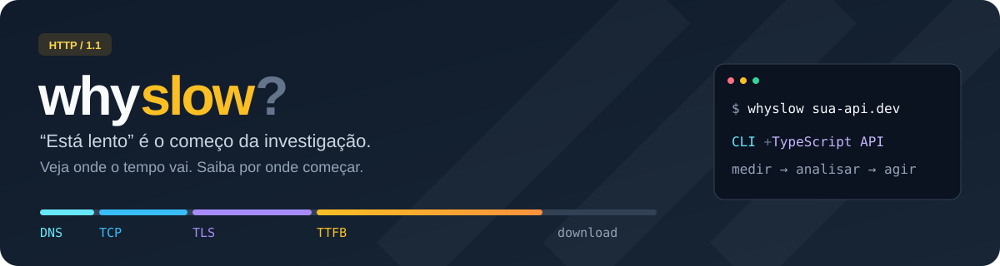
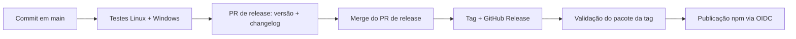

<p align="center">
  
</p>

<p align="center">
  <a href="https://github.com/juninmd/whyslow/actions/workflows/ci.yml"></a>
  
  
  <a href="https://www.conventionalcommits.org/en/v1.0.0/"></a>
</p>

<h1 align="center">whyslow</h1>

<p align="center"><strong>“Está lento” não é diagnóstico.</strong><br>Encontre a etapa que merece investigação, com um comando ou uma chamada de função.</p>

<p align="center">
  <a href="#instalação">Instalação</a> · <a href="#como-biblioteca">Biblioteca</a> · <a href="#pela-cli">CLI</a> · <a href="#releases-semânticas-e-publicação-npm">Releases</a>
</p>

Descubra em qual etapa uma requisição HTTP está lenta: **DNS, TCP, TLS, espera pela resposta ou download**. O whyslow mede um endpoint, compara amostras e entrega hipóteses de investigação com ações sugeridas.

Use pela CLI durante uma investigação ou importe a biblioteca em scripts, bots e ferramentas de diagnóstico. A saída inclui p50/p95, custo de conexão, achados e amostras cruas. As sugestões orientam a investigação; não comprovam a causa interna do servidor.

| Investigue | Entenda | Integre |
|---|---|---|
| DNS, TCP, TLS, TTFB e download separados | Percentis, custo de conexão e hipóteses com próximos passos | CLI, JSON e API ESM com tipos TypeScript |

## Instalação

**Node.js 22 ou superior.** O pacote é ESM, inclui tipos TypeScript e não tem dependências de execução. Bun é usado no desenvolvimento; não é necessário para consumir o pacote npm.

O pacote ainda não foi publicado no registry. Para instalar a versão local, na raiz do repositório:

```bash
bun install --frozen-lockfile
npm pack
```

O `npm pack` compila automaticamente o projeto e gera um tarball `whyslow-<versão>.tgz`. Por exemplo, para a versão `0.1.0`, no projeto consumidor:

```bash
npm install /caminho/para/whyslow-0.1.0.tgz
```

Após a publicação desta versão no registry, a instalação passa a ser:

```bash
npm install whyslow
```

## Como biblioteca

```js
import { diagnose } from 'whyslow';

const { finalUrl, analysis, samples } = await diagnose(
  'https://api.exemplo.com/health',
  {
    samples: 10,
    timeoutMs: 5000,
    headers: { 'accept': 'application/json' },
  },
);

console.log(finalUrl);
console.log(`p50: ${analysis.totalP50} ms; p95: ${analysis.totalP95} ms`);
console.log(`Abrir conexão: ${analysis.connectionMs} ms`);
console.log(analysis.findings);
console.log(`${samples.length} amostras coletadas`);
```

A biblioteca retorna dados: não imprime no terminal nem chama `process.exit()`. Falhas de rede e respostas HTTP fora de 2xx/3xx aparecem nas amostras e nos achados; URL ou opções inválidas rejeitam a Promise. Trate essas exceções com `try/catch` no seu código.

### API pública

| Exportação | Uso |
|---|---|
| `diagnose(url, options?)` | Mede e analisa; retorna `Promise<{ finalUrl, analysis, samples }>` |
| `measure(url, options, count)` | Mede sem analisar; exige URL absoluta e todas as `ProbeOptions` |
| `analyze(url, samples)` | Analisa amostras existentes, sem acessar a rede |
| `render(analysis)` | Converte a análise em texto para terminal |
| `normalizeUrl(url)` | Assume HTTPS quando falta esquema; aceita HTTP e HTTPS |

Os tipos `DiagnoseOptions`, `Diagnosis`, `ProbeOptions`, `Analysis`, `Sample`, `Finding`, `Phase`, `PhaseStat` e `Severity` também são exportados:

```ts
import { diagnose, analyze, render } from 'whyslow';
import type { DiagnoseOptions, Diagnosis } from 'whyslow';

const options: DiagnoseOptions = { samples: 5, keepAlive: true };
const result: Diagnosis = await diagnose('http://localhost:3000/health', options);

// Reanalisa os mesmos dados, sem fazer novas requisições.
const analysis = analyze(result.finalUrl, result.samples);
console.log(render(analysis));
```

### Opções de `diagnose`

| Campo | Padrão | Efeito |
|---|---|---|
| `samples` | `5` | Quantidade de amostras; inteiro positivo |
| `timeoutMs` | `10000` | Timeout TCP por endereço, handshake TLS e inatividade HTTP, em ms |
| `method` | `'GET'` | Método HTTP; não há opção para enviar corpo |
| `headers` | `{}` | Cabeçalhos extras; podem substituir os padrões `user-agent` e `accept-encoding` |
| `keepAlive` | `true` | Permite reaproveitar a conexão HTTP entre amostras |
| `maxRedirects` | `5` | Máximo de redirecionamentos seguidos; `0` desliga a descoberta e o aquecimento |
| `insecure` | `false` | Aceita certificados TLS inválidos |

`timeoutMs` aceita inteiros de 1 a 2147483647; `maxRedirects` aceita inteiros não negativos. O timeout **não é um prazo total da execução**: DNS usa os limites do sistema, e tentativas, redirecionamentos e amostras são sequenciais.

## Pela CLI

Com o pacote instalado no projeto:

```bash
npx --no-install whyslow http://localhost:3000/health
npx --no-install whyslow exemplo.com -n 10
npx --no-install whyslow https://api.exemplo.com/health --json
```

Sem esquema, o alvo usa HTTPS. Para executar a partir do código-fonte:

```bash
bun run start --help
bun run start http://localhost:3000/health -n 10
```

| Flag | Efeito |
|---|---|
| `-n, --samples <n>` | Amostras; padrão `5` |
| `-X, --method <verbo>` | Método HTTP; padrão `GET` |
| `-H, --header 'K: V'` | Cabeçalho extra; repetível |
| `--timeout <ms>` | Timeout de conexão/inatividade; padrão `10000` |
| `--no-keepalive` | Abre conexão HTTP nova em cada amostra |
| `--max-redirects <n>` | Limite de saltos; padrão `5` |
| `--insecure` | Aceita certificado inválido |
| `--json` | JSON com `analysis` e `samples` |
| `-h, --help` | Mostra a ajuda |

Códigos de saída: **0** sem avisos/críticos, **1** com avisos, **2** com achados críticos, **3** para erro de uso ou exceção inesperada. Com `--json`, stdout contém o resultado; erros de execução vão para stderr. Isso permite salvar os dados e decidir a ação pelo código de saída.

## Como interpretar os tempos

- **`totalP50` / `totalP95`**: percentis de TTFB + download. Com uma conexão HTTP realmente reaproveitada, representam o tempo da requisição sem abrir conexão.
- **`connectionMs`**: soma das medianas de DNS + TCP + TLS, medidas num socket separado e descartado. Com keep-alive, normalmente há apenas uma medição de conexão por execução.
- **Fases e percentuais**: mostram a participação de cada mediana na soma das fases. A estimativa de primeira chamada soma `connectionMs` e `totalP50`; não é o tempo observado de uma única requisição.

Por exemplo, uma requisição de 5 ms com abertura de conexão de 300 ms sugere investigar reaproveitamento de conexões. Uma resposta que demora 900 ms até os cabeçalhos sugere investigar aplicação, proxy e caminho de rede.

Uma fase dominante só gera aviso/crítico de lentidão quando a mediana da requisição também ultrapassa os pisos da análise. Ser responsável por 90% de uma resposta rápida não basta para gerar alarme.

## O que a análise aponta

| Achado | Indicação |
|---|---|
| `culprit-dns`, `culprit-tcp`, `culprit-tls` | Resolução, conexão ou handshake dominam a decomposição |
| `culprit-ttfb`, `culprit-download` | Espera pela resposta ou transferência domina |
| `address-fallback` | Um endereço falha antes de outro aceitar conexão |
| `keepalive-gain` | Abrir conexão custa mais de 20 ms |
| `no-compression` | Texto maior que 2 KB sem `content-encoding` |
| `redirects` | Há saltos antes do destino medido |
| `unstable` | p95 maior que 3× p50, com piso de 200 ms e ao menos 3 amostras |
| `flaky`, `unreachable` | Parte ou todas as amostras falham |
| `cert-expiring` | Certificado expira em menos de 21 dias; crítico abaixo de 7 |
| `http1` | Resposta HTTP/1.1 maior que 100 KB; informativo |

## Precisão e limites

- A implementação usa **HTTP/1.1** via `node:http`/`node:https`; não mede HTTP/2, HTTP/3, navegador ou renderização de página.
- DNS/TCP/TLS e a requisição HTTP usam conexões diferentes. O probe tenta endereços sequencialmente; o cliente HTTP pode escolher outro endereço ou estratégia de conexão. O fallback observado não prova que todo cliente terá o mesmo atraso.
- Com `keepAlive: false`, sem aquecimento ou quando o servidor fecha o socket, o TTFB pode incluir abertura de conexão. Nesses casos, somar `connectionMs` ao tempo da requisição pode contar esse custo duas vezes.
- A descoberta de redirecionamentos pode fazer requisições extras e aquecer o destino antes das amostras. O whyslow não mede o primeiro acesso a uma aplicação fria. Prefira endpoints de leitura, como health checks; o método configurado também é usado nas requisições extras.
- Ao mudar de origem num redirecionamento (protocolo, host ou porta), todos os cabeçalhos personalizados são removidos, incluindo tokens em nomes próprios. Eles também não são enviados nas amostras do destino final. Na mesma origem, são preservados.
- Cinco amostras ajudam na triagem; não bastam para caracterizar uma cauda de latência em produção. Amostras sem tempos completos entram nos percentis com zero para fases ausentes; confira `analysis.ok` e as falhas antes de interpretar os números.
- Um alvo por execução, sem concorrência de carga, monitoramento contínuo, corpo de requisição ou tratamento de `Retry-After`.

## Releases semânticas e publicação npm

O fluxo usa [Release Please](https://github.com/googleapis/release-please) e [Conventional Commits](https://www.conventionalcommits.org/en/v1.0.0/). A versão sai do histórico de commits; você não precisa editar `package.json` a cada mudança.



| Commit | Efeito na próxima versão |
|---|---|
| `fix(probe): corrige timeout TLS` | Patch: `1.2.3` → `1.2.4` |
| `feat(api): adiciona uma opção` | Minor: `1.2.3` → `1.3.0` |
| `feat(api)!: altera o retorno` ou rodapé `BREAKING CHANGE:` | Major: `1.2.3` → `2.0.0` |
| `docs:`, `test:`, `ci:`, `chore:` | Não iniciam release sozinhos |

Use esses formatos também no título do PR ao fazer squash merge. O Release Please mantém um PR de versão; o merge desse PR gera a tag `vX.Y.Z` e a GitHub Release. Não há merge automático. A CI do PR de release é disparada explicitamente para funcionar com o `GITHUB_TOKEN`, sem PAT adicional.

### Configuração inicial do mantenedor

A publicação automática começa desativada. A versão local inicial é `0.1.0`; a primeira publicação exige autenticação da conta npm e criação do pacote. Primeiro, faça merge do PR inicial de release gerado pelo bot, para registrar a versão e a tag no GitHub. Em seguida, confira a versão daquela release (o exemplo usa `v0.1.0`) e publique o pacote a partir da tag:

```bash
npm login
git fetch --tags
git switch --detach v0.1.0
bun install --frozen-lockfile
bun test
bun run typecheck
npm run test:package
npm publish --access public
```

Depois, nas configurações de **Trusted Publishing** do pacote no npm, cadastre:

| Campo | Valor |
|---|---|
| Provedor | GitHub Actions |
| Organization or user | `juninmd` |
| Repository | `whyslow` |
| Workflow filename | `release.yml` |
| Environment | Em branco |
| Allowed actions | Permitir publicação direta com `npm publish` |

Com a relação de confiança configurada, habilite a variável do repositório:

```bash
gh variable set NPM_PUBLISH_ENABLED --body true --repo juninmd/whyslow
```

O workflow usa Node 24, `id-token: write` e publicação com OIDC, sem `NPM_TOKEN`. O npm gera a proveniência para o pacote público publicado pelo repositório público. Consulte os requisitos atuais no [guia de Trusted Publishing do npm](https://docs.npmjs.com/trusted-publishers/).

Se uma GitHub Release já existir e a publicação precisar ser repetida após corrigir a configuração:

```bash
gh workflow run release.yml --ref main -f tag=v0.1.0 --repo juninmd/whyslow
```

Substitua `v0.1.0` pela tag real. O workflow exige release estável existente, versão correspondente no `package.json` e tag ancestral de `main`; testa o pacote daquela tag antes de publicar. Uma versão já publicada no npm não pode ser sobrescrita. Para suspender novas publicações, defina `NPM_PUBLISH_ENABLED=false`.

## Desenvolvimento e validação

```bash
bun install --frozen-lockfile
bun test
bun run typecheck
npm run build
npm run test:package
```

O build gera JavaScript ESM e declarações `.d.ts` em `dist/`, reescrevendo imports locais para `.js`. A entrada da biblioteca é `dist/index.js`; a CLI é `dist/cli.js`.

Os testes cobrem regras de análise, argumentos, integração HTTP local, redirecionamentos e timeout TLS. `test:package` empacota com `npm pack`, instala o tarball num projeto temporário e valida import sem efeitos colaterais, diagnóstico HTTP com Node, resolução de tipos TypeScript, CLI e execução via npm. O projeto temporário é removido ao terminar.
